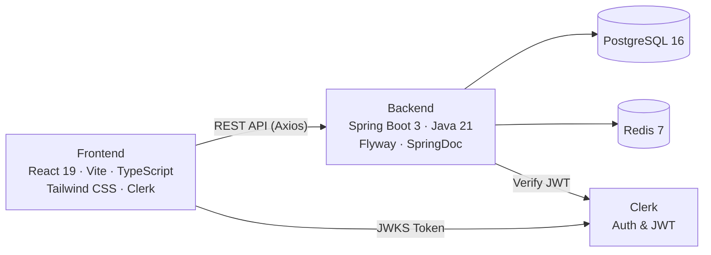

# 🛒 Soopi Shop

> **UIT – Học phần Quản lý Dự án | Nhóm 16**
>
> Nền tảng thương mại điện tử kinh doanh **linh kiện máy tính**, được xây dựng theo kiến trúc tách biệt Frontend / Backend.

---

## 📂 Cấu trúc dự án

```
Soopi_Shop/
├── backend/        # Spring Boot 3 – REST API, PostgreSQL, Redis, Clerk JWT
│   └── README.md   → Hướng dẫn chi tiết backend
├── frontend/       # React 19 + Vite + TypeScript – Giao diện người dùng
│   └── README.md   → Hướng dẫn chi tiết frontend
├── docs/               # Tài liệu dự án (sơ đồ, thiết kế, đặc tả)
│   └── CONTRIBUTING.md → Quy ước Git: branch, commit, PR
└── README.md           # (file này)
```

---

## 🔗 Tài liệu chi tiết

| Module | Mô tả | README |
| :--- | :--- | :--- |
| **Backend** | Spring Boot 3, PostgreSQL 16, Redis 7, Clerk OAuth2 | [backend/README.md](./backend/README.md) |
| **Frontend** | React 19, Vite 8, Tailwind CSS v4, Zustand, TanStack Query | [frontend/README.md](./frontend/README.md) |
| **Đóng góp** | Quy ước nhánh, commit, quy trình PR | [docs/CONTRIBUTING.md](./docs/CONTRIBUTING.md) |

---

## ⚙️ Yêu cầu môi trường

| Công cụ | Phiên bản tối thiểu | Dùng cho |
| :--- | :--- | :--- |
| **Docker** | 24+ | Chạy cả backend lẫn frontend |
| **Docker Compose** | v2 (plugin) | Orchestrate services |
| **Node.js** | 20.x hoặc 22.x | Phát triển frontend không qua Docker |
| **JDK** | 21 | Phát triển backend không qua Docker |

---

## 🚀 Khởi động nhanh (Full Stack)

### Bước 1 — Clone & chuẩn bị file `.env`

```bash
git clone https://github.com/Soopi-Shop/Soopi_Shop.git
cd Soopi_Shop

# Backend
cp backend/.env.example backend/.env
# → Chỉnh sửa backend/.env với credentials thực của bạn

# Frontend
cp frontend/.env.example frontend/.env
# → Điền VITE_CLERK_PUBLISHABLE_KEY thực của bạn từ Clerk Dashboard
```

### Bước 2 — Khởi chạy Backend (PostgreSQL + Redis + Spring Boot)

```bash
cd backend
docker compose -f docker-compose.dev.yml up -d
```

> Backend sẽ chạy tại `http://localhost:8000`

### Bước 3 — Khởi chạy Frontend

```bash
cd ../frontend
docker compose -f docker-compose.dev.yml up -d
```

> Frontend sẽ chạy tại `http://localhost:5173`

---

## 🛠️ Tech Stack tổng quan

